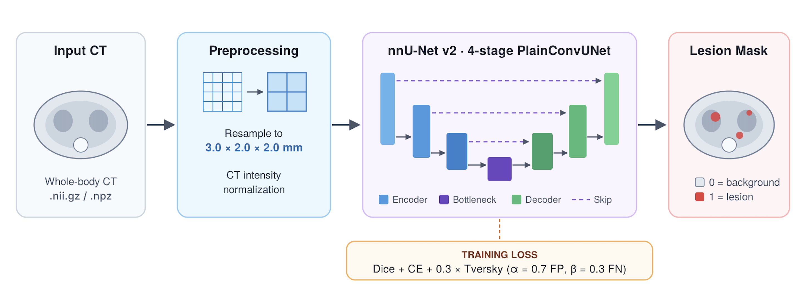

# Coarse-Spacing nnU-Net with Tversky Loss for Pan-Cancer CT Segmentation

🏆 **Outstanding Winner Award — FLARE 2026 Challenge (MICCAI 2026), Task 1**

[](https://openreview.net/forum?id=Os4tClciJv)
[](https://www.codabench.org/competitions/7149/)
[](#quick-start)
[](https://github.com/MIC-DKFZ/nnUNet)

</div>

Whole-body pan-cancer lesion segmentation in CT, packaged as a ready-to-run Docker image.

<p align="center"></p>

| | |
|---|---|
| **Task** | Binary lesion segmentation (whole-body CT) |
| **Architecture** | 4-stage nnU-Net v2 (`PlainConvUNet`) |
| **Target spacing** | 3.0 × 2.0 × 2.0 mm |
| **Loss** | Dice + CE + 0.3 × Tversky (α = 0.7, β = 0.3) |
| **Inference** | ~3–4 s per case · ~1.4 GB GPU memory |

---

## Method

**Coarse spacing.** Standard nnU-Net resamples to the dataset's median spacing. We resample to a coarser **3.0 × 2.0 × 2.0 mm** instead (configuration `3d_fullres_2mm`). Each patch then covers more of the body, which gives more anatomical context and greatly reduces runtime and memory. nnU-Net's automatic planning produces a compact 4-stage network at this spacing. All other preprocessing, including CT intensity normalization, follows nnU-Net defaults.

**Tversky loss.** We add 0.3 × Tversky to the standard Dice + CE loss. With α = 0.7 (false positives) and β = 0.3 (false negatives), it penalizes false positives more strongly, which suppresses spurious detections across whole-body scans.

| Training setting | Value |
|---|---|
| Epochs | 2000 |
| Initial learning rate | 1e-3 |
| Folds | `all` (single model) |
| Test-time augmentation | None |
| Everything else | nnU-Net v2 defaults |

---

## Quick Start

### 1. Install Docker

Install Docker by following the [official guide](https://docs.docker.com/get-docker/), then check that it works:

```bash
docker --version
```

### 2. Load the Docker image

```bash
docker load -i panseg_spi26.tar.gz
docker images   # check the image name
```

### 3. Prepare your data

Put CT scans in `inputs/` and create an empty `outputs/` folder. File names must end in `_0000.nii.gz`.

```text
inputs/
├── case_0001_0000.nii.gz
├── case_0002_0000.nii.gz
└── ...
outputs/
```

### 4. Run inference

```bash
docker container run --gpus "device=0" -m 28G --name panseg --rm \
  -v $PWD/inputs/:/workspace/inputs/ \
  -v $PWD/outputs/:/workspace/outputs/ \
  panseg_spi26:latest /bin/bash -c "sh predict.sh"
```

### 5. Output

Masks are written to `outputs/` without the `_0000` suffix (`case_0001_0000.nii.gz` → `case_0001.nii.gz`). They keep the same spacing and geometry as the input.

| Label | Meaning |
|---|---|
| `0` | Background |
| `1` | Lesion |

---

## Troubleshooting

| Problem | Fix |
|---|---|
| `outputs/` is empty | Check that inputs end in `_0000.nii.gz`. |
| Permission denied on `outputs/` | Run `chmod 777 outputs/`. |
| Container name already in use | Change `--name`, or run `docker rm panseg`. |

---

## Citation

```bibtex
@inproceedings{nayak2026coarse,
  title     = {Coarse-Spacing nnU-Net with Tversky Loss for Pan-Cancer CT Segmentation},
  author    = {Nayak, L. and Ebrahimpour, S. L. and Jiang, J.},
  booktitle = {FLARE 2026 Challenge at MICCAI 2026},
  year      = {2026},
  url       = {https://openreview.net/forum?id=Os4tClciJv}
}
```

Please also cite [nnU-Net](https://github.com/MIC-DKFZ/nnUNet).

## Acknowledgements

We thank the FLARE 2026 organizers for the dataset and evaluation platform, and the nnU-Net authors for their open-source framework.

For questions, please open an issue in this repository.
